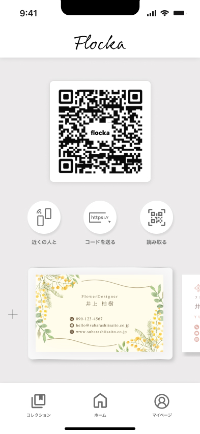
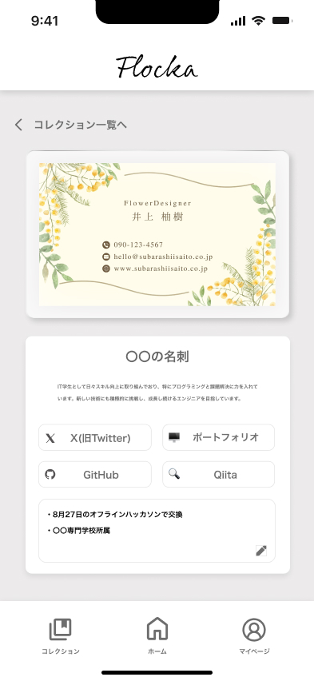

# Flocka　(フロッカ)

Flocka は、趣味やコミュニティごとに使い分けられる電子名刺（プロフィールカード）を交換できるモバイルアプリです。このリポジトリでアプリとAPIを一緒に管理します。


| | | |
| --- | --- | --- |
|  |  |  |

## リポジトリ構成

- [`frontend/`](frontend/) は Expo Router、React Native、TypeScript のアプリです。
- [`backend/`](backend/README.md) は Cloudflare Workers、Hono、D1、R2 のAPIです。

## ローカル開発

Node.js 22 と npm を使用します。以下のコマンドはリポジトリのルートで実行します。

```bash
npm --prefix frontend ci
npm --prefix backend ci
cp backend/.dev.vars.example backend/.dev.vars
cp frontend/.env.example frontend/.env.local
npm --prefix backend run db:init
npm --prefix backend run dev
```

APIが `http://127.0.0.1:8787/` で起動したら、別のターミナルでアプリを起動します。

```bash
npm --prefix frontend start
```

`frontend/.env.local` の `EXPO_PUBLIC_API_URL` には、アプリを実行する端末から到達できるURLを設定します。Androidエミュレーターでは `http://10.0.2.2:8787` を指定します。実機では開発PCのLANアドレスを指定し、APIを `npm --prefix backend run dev -- --ip 0.0.0.0` で起動します。変数が未設定の場合、アプリは `https://api.flocka.net` に接続します。

## 検証

```bash
npm --prefix frontend run lint
npm --prefix backend run type-check
npm --prefix backend run build
```

## 主要な画面と機能

- `/` (Home) — QR 表示、カード切替、アクション（読み取りなど）
- `/sign-in` — ログイン
- `/sign-up` — 新規登録
- `/sign-up-auth` — メール認証待ち（再送ボタンなど）
- `/forgot-password` — パスワードリセット申請
- `/reset-password` — パスワード再設定（トークン入力）
